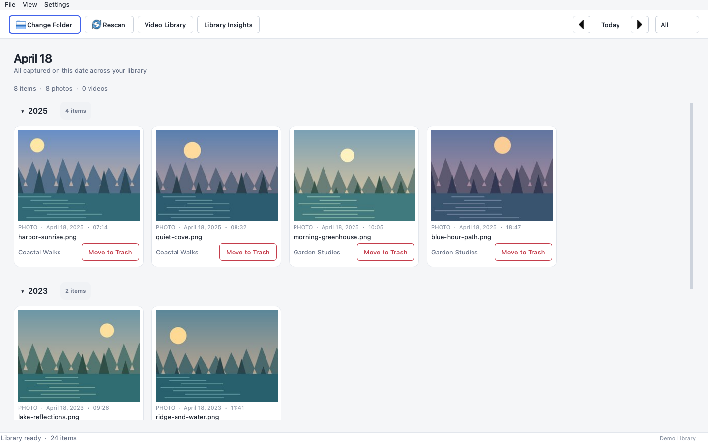
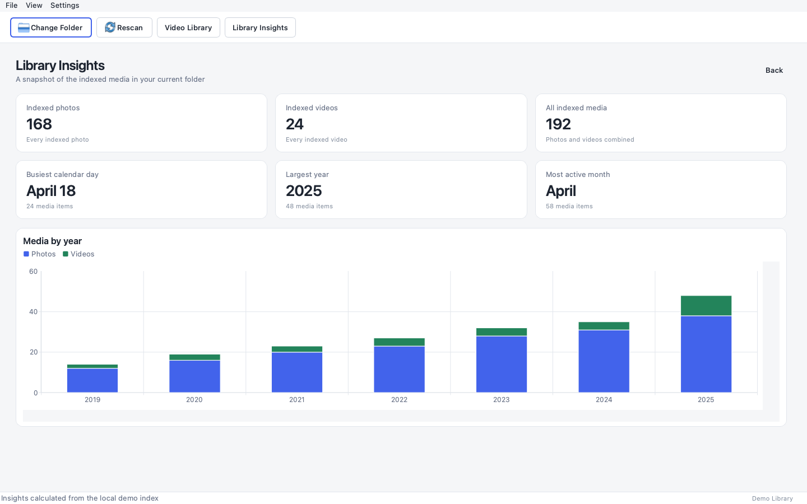
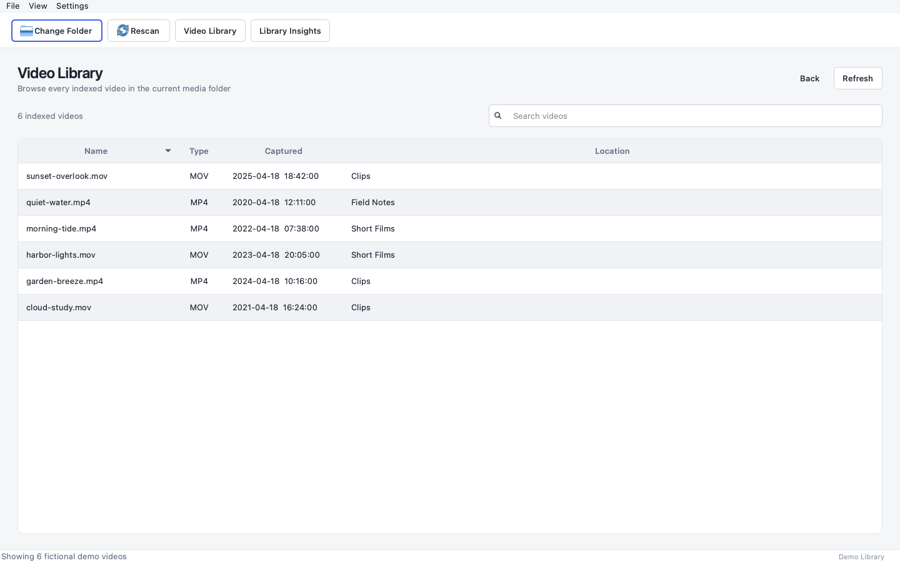

# On This Day

A privacy-first desktop app for rediscovering photos and videos captured on the
same calendar day across different years.

On This Day turns a local media folder into a focused daily timeline. It reads
capture dates from media metadata, builds a reusable SQLite index, and presents
matching moments in a polished PySide6 interface. Media inspection, thumbnail
generation, search, and library analytics all stay on your computer.

## Highlights

- Recursively indexes a local folder without uploading its contents.
- Groups matching photos and videos by capture year for the selected month and day.
- Browses the previous day, next day, or today's date from the main toolbar.
- Filters the gallery to all media, photos only, or videos only.
- Generates Retina-ready thumbnails away from the main interface and reuses cached results.
- Keeps the interface responsive: date lookups, thumbnails, and photo decoding all happen
  in the background, and scans read capture dates in parallel.
- Loads large year groups in batches to keep the gallery responsive.
- Includes a searchable, sortable library of every indexed video.
- Calculates folder-specific Library Insights from the existing SQLite index.
- Opens photos and videos in a full-window viewer with zoom, pan, and in-app video
  playback. Any item can still be opened in its default application.
- Supports system, light, and dark appearance modes.
- Moves an item to the operating system's Trash only after explicit confirmation.
- Preserves the existing app settings, media index, and compatible thumbnail cache.

## Screenshots

The screenshots below were captured from a disposable demo library containing
synthetic artwork, fictional filenames, and fictional dates. They contain no
personal media, real library paths, or embedded metadata.

### Date-based gallery

Browse matching moments by year, switch between photos and videos, and manage an
item directly from its gallery card.



### Library Insights

Review folder-specific totals, highlights, and the photo-and-video mix over time.



### Video Library

Search and sort indexed videos without leaving the desktop app.



## How it works

1. Choose the folder containing your photo and video library.
2. The app recursively scans supported media and stores file details and detected
   capture dates in a local SQLite index. High-resolution previews are cached for
   sharp display, while compatible legacy thumbnails can appear as placeholders.
3. The gallery queries that index for media captured on the selected month and day,
   then groups the results from newest to oldest year.
4. Later scans reuse unchanged records, update changed files, and remove index
   entries (and cached thumbnails) for files that are no longer present. If the
   folder is unavailable, such as an unplugged drive, or contains no media at all,
   the scan leaves the existing index untouched.

The initial scan can take time for a large library. Subsequent scans are faster
because unchanged files do not need to be analyzed again.

## Requirements

- Python 3.10 or newer
- macOS 11 or later, or Windows 10 or 11 (Windows is supported but has had less testing)
- Read access to the selected media folder
- Permission to modify the selected folder only if using **Move to Trash**

Python dependencies are installed from `requirements.txt`:

- [PySide6](https://doc.qt.io/qtforpython-6/) for the desktop interface and charts
- [Pillow](https://pillow.readthedocs.io/) for image metadata and thumbnails
- [pillow-heif](https://github.com/bigcat88/pillow_heif) for HEIC and HEIF support
- [imageio-ffmpeg](https://github.com/imageio/imageio-ffmpeg) for video metadata
  and thumbnails

The app still starts if HEIC/HEIF or FFmpeg support is unavailable, but the related
media formats or video features will be limited.

## Installation

### 1. Clone the repository

```bash
git clone https://github.com/bardakanian/on-this-day-photo-viewer.git
cd on-this-day-photo-viewer
```

### 2. Create and activate a virtual environment

macOS:

```bash
python3 -m venv .venv
source .venv/bin/activate
```

Windows (PowerShell):

```powershell
py -m venv .venv
.venv\Scripts\Activate.ps1
```

### 3. Install dependencies

```bash
python -m pip install --upgrade pip
python -m pip install -r requirements.txt
```

### 4. Launch the app

```bash
python app.py
```

On first launch, choose a folder containing photos and videos. The selected folder,
appearance preference, SQLite index, thumbnail cache, and application log are kept
in the local app-data directory described below.

### 5. Optional: add it to Applications (macOS) or the Start menu (Windows)

```bash
python tools/make_launcher.py
```

- **macOS:** builds `On This Day.app` and installs it in `/Applications`, so you can
  start it from Launchpad, Spotlight or the Dock. Use `--user` to install in
  `~/Applications` instead. App output goes to `~/.on_this_day_photo_viewer/launcher.log`.
- **Windows:** adds an **On This Day** shortcut to the Start menu. Add `--desktop` for a
  Desktop shortcut too. The shortcut starts the app with `pythonw`, so no console
  window opens.

Either way, the launcher runs `app.py` with the project's `.venv`, so it always starts
your latest code. Re-run the script if you move the project folder.

## Using the app

### Browse the daily gallery

- Use **Choose Folder** to select or change the active media library.
- Use **Rescan** after adding, moving, editing, or removing files outside the app.
- Use the arrow controls to browse adjacent dates or **Today** to return to the
  current date.
- Use the media filter to show all items, photos only, or videos only.
- Select a thumbnail to open it in the viewer (see below).
- Collapse or expand a year section to focus the timeline.

### Search the Video Library

Open **Video Library** to browse every indexed video in the selected folder. The
table can be searched and sorted by its visible columns. Search matches the filename,
media type, capture timestamp, and containing folder shown in the table. Double-click
a row, or right-click it and choose **Open Video**, to play it in the viewer.

### View photos and videos

Opening an item shows it full-window, with the main toolbar hidden. The top bar shows
the filename and capture date, your position in the list (for example **3 of 12**),
and buttons for **Open in Default App** and **Move to Trash**.

- **Moving between items:** use **←** and **→** (or the arrow buttons), and **Home**
  or **End** for the first or last item. From the gallery, this steps through every
  item for the selected day, across all years, including items not yet shown with
  **Load more**. From the Video Library, it follows the table's current sort order and
  search results.
- **Going back:** press **Esc** or select **‹ Back**. You return to the page you came
  from, at the same scroll position.

**Photos** open with their EXIF rotation applied, fitted to the window. The gallery
thumbnail appears at once, and a screen-sized version replaces it a moment later.

- **Zoom:** hold **⌘** and scroll, pinch on a trackpad, or press **⌘=** and **⌘−**.
  Zoom follows the pointer.
- **Fit or actual size:** double-click the photo, select **100%** / **Fit**, or press **⌘0**.
- **Pan:** drag the photo, or scroll while zoomed in.
- Zooming past screen resolution loads the full-resolution photo without moving the view.
- The previous and next photos are prepared in the background, so stepping through a
  day is quick.

**Videos** start playing when opened.

- **Play or pause:** select ▶ or press **Space**.
- **Seek:** drag the progress bar, click anywhere on it, or press **⇧←** / **⇧→** to
  move 5 seconds.
- **Sound:** use the volume slider, or press **M** to mute.
- If a video can't be played in the app, the viewer says so and offers **Open in
  Default App**.

### Explore Library Insights

Open **Library Insights** from the main toolbar or the **View** menu. The dashboard
uses the current folder's existing SQLite index, so it does not rescan the
filesystem. It includes:

- Total indexed photos, videos, and combined media
- The busiest calendar day across all capture years, including February 29
- The capture year containing the most indexed media
- The most active calendar month across all capture years
- A chronological stacked bar chart of photos and videos by capture year
- Exact photo, video, and total values in chart hover details

Records without the date components required by a statistic are omitted only from
that calculation and still count toward library totals. When counts tie, the
earliest calendar day, year, or month is selected consistently.

### Move media to Trash

Each gallery card includes **Move to Trash**, and so does the viewer (**⌘⌫**). The
app shows the exact filename and requires confirmation before asking the operating
system to move the original file to Trash. In the viewer, playback stops first so the
file can be moved, and the next item is shown afterwards. After a successful move, the matching SQLite record and cached
thumbnail are removed and the gallery and Library Insights are refreshed.

This action affects the original media file. Confirm that your system Trash and
backups meet your recovery needs before using it.

## Capture-date detection

Each file's capture date comes from the first of these that exists:

1. **Embedded metadata:** EXIF for images, and the creation time inside the video (read with FFmpeg).
2. **A date macOS Spotlight found in the file's content** (macOS only). It's ignored when it equals the
   file's own creation time, because then it's just when the file was copied to this disk.
3. **The earlier of the file's creation and modification times.** Copying a file to a
   backup drive resets its creation time but keeps its modification time, so the earlier
   one is closer to when the photo or video was made.

"Zero" and unset-clock dates (January 1, 1970, which shows as December 31, 1969 in US
time zones; January 1, 1980; January 1, 1904; and dates in the future) are never treated
as capture dates; the next source is used instead. After an update to these rules, the
next scan re-reads every file once.

Because metadata can be missing or incorrect, review detected dates before relying
on the index for organizational decisions.

## Supported media

| Category | Formats |
| --- | --- |
| Images | JPG, JPEG, PNG, TIFF, BMP, GIF, WebP, HEIC, HEIF |
| Videos | MOV, MP4, M4V, AVI, MKV, WMV, MPEG, MPG, 3GP |

Animated images use their first readable frame for the cached thumbnail. Video
thumbnail and embedded-date support depend on the bundled FFmpeg capability.
In-app video playback uses Qt Multimedia; a video it can't play can still be opened
in its default application from the viewer.

## Privacy and local data

On This Day performs media processing locally. The application contains no account
sign-in, advertising, telemetry, analytics reporting, cloud synchronization, or
media-upload feature.

Application data is stored under:

```text
~/.on_this_day_photo_viewer/
├── config.json
├── on_this_day.log
├── photo_index.sqlite3
└── thumbnails/
```

The configuration and SQLite index can contain the absolute path of the selected
library and individual media files. The log can contain operational error details.
Do not publish or commit this app-data directory.

The app normally reads source media to identify dates, create thumbnails, and open
files on request. The only intentional source-file modification is the explicitly
confirmed **Move to Trash** action.

## Keyboard shortcuts

The shortcuts below are shown for macOS. On Windows, use `Ctrl` in place of `⌘`
(for example `Ctrl+O`), and `Shift` in place of `⇧`.

| Action | Shortcut |
| --- | --- |
| Choose media folder | `⌘O` |
| Rescan library | `⌘R` |
| Previous day | `⌘←` |
| Next day | `⌘→` |
| Go to today | `⌘T` |
| Open Video Library | `⌘⇧V` |
| Open Library Insights | `⌘⇧I` |
| Search videos | `⌘F` |
| Open settings | `⌘,` |
| Close window | `⌘W` |

In the viewer:

| Action | Shortcut |
| --- | --- |
| Previous / next item | `←` / `→` |
| First / last item | `Home` / `End` |
| Back to the gallery or Video Library | `Esc` |
| Play or pause a video (closes a photo) | `Space` |
| Skip back / forward 5 seconds | `⇧←` / `⇧→` |
| Mute | `M` |
| Zoom in / out | `⌘=` / `⌘−` |
| Fit or actual size | `⌘0` |
| Move to Trash | `⌘⌫` |

## Project structure

```text
app.py                    Application entry point
CHANGELOG.md              Version history (the version itself is VERSION in core/constants.py)
onthisday/
├── core/
│   ├── constants.py      App name, VERSION, paths, and file types
│   ├── database.py       SQLite repository and Library Insights queries
│   ├── indexer.py        Recursive, incremental, parallel media indexing
│   ├── media.py          Metadata detection, thumbnails, and viewer image decoding
│   ├── models.py         Shared immutable data models
│   ├── settings.py       Local configuration persistence
│   ├── workqueue.py      Background job queue for the viewer
│   └── zoom.py           Zoom and pan arithmetic for the photo viewer
└── ui/
    ├── pages/            Gallery, Video Library, Library Insights, and the viewer
    ├── theme/            Color palettes, typography, metrics, and stylesheets
    ├── viewer_images.py  Background photo decoding with neighbour prefetch
    └── widgets/          Media cards, photo canvas, video player, and shared controls
tools/make_launcher.py    macOS app / Windows Start-menu shortcut builder
tests/                    Storage, indexing, date, viewer, and Windows tests
assets/screenshots/       Sanitized documentation screenshots
```

## Development

Run the automated tests from the project root:

```bash
python -m unittest discover -s tests -v
```

Check that the application modules compile:

```bash
python -m compileall -q onthisday app.py
```

For this checkout, the project virtual environment can be used directly:

```bash
.venv/bin/python -m unittest tests.test_core -v
```

## Troubleshooting

- **HEIC or HEIF files are missing:** confirm that `pillow-heif` installed in the
  same environment used to launch the app.
- **Video dates or thumbnails are unavailable:** confirm that `imageio-ffmpeg` is
  installed, then rescan the library.
- **Recently changed media is not visible:** use **Rescan** to refresh the index.
- **A detected date looks wrong:** inspect the file's EXIF, embedded video metadata,
  Spotlight metadata, and filesystem timestamps.
- **The app cannot move a file to Trash:** confirm that the file still exists and
  the current user has permission to modify its containing folder. On Windows, files go
  to the Recycle Bin, and a file can't be moved while another program has it open.

## Project status

The app is under active development. Use a backed-up media library, review detected
capture dates, and keep the local app-data directory out of source control.

## Development approach

Developed with AI-assisted tools under human direction, review, testing, and refinement.

## License

This project is available under the [MIT License](https://github.com/bardakanian/on-this-day-photo-viewer?tab=MIT-1-ov-file).
